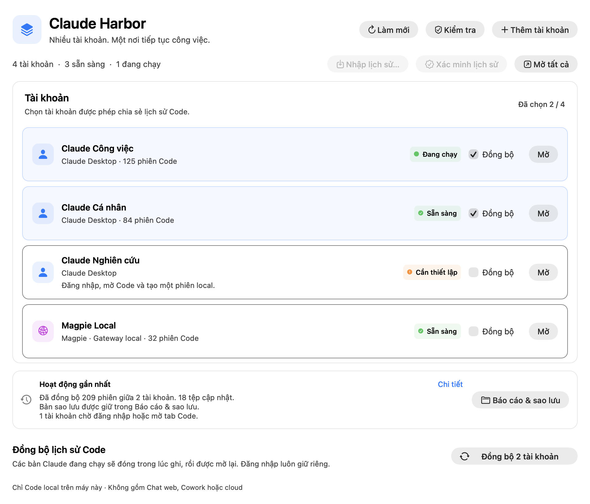
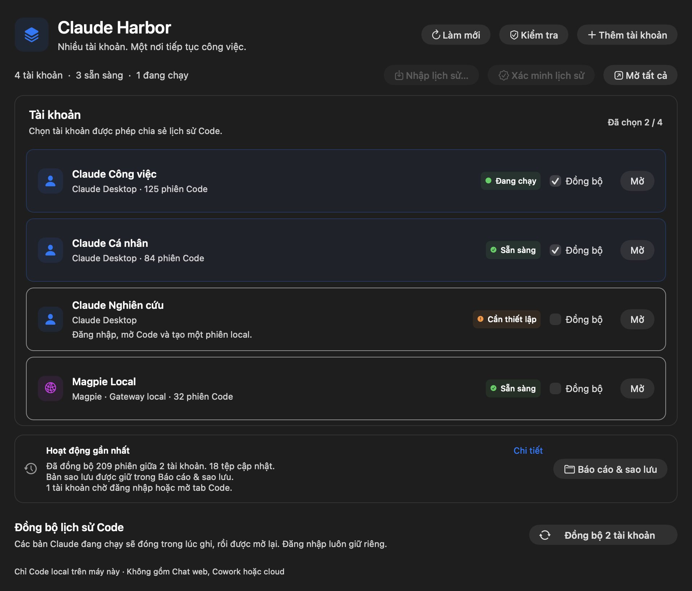
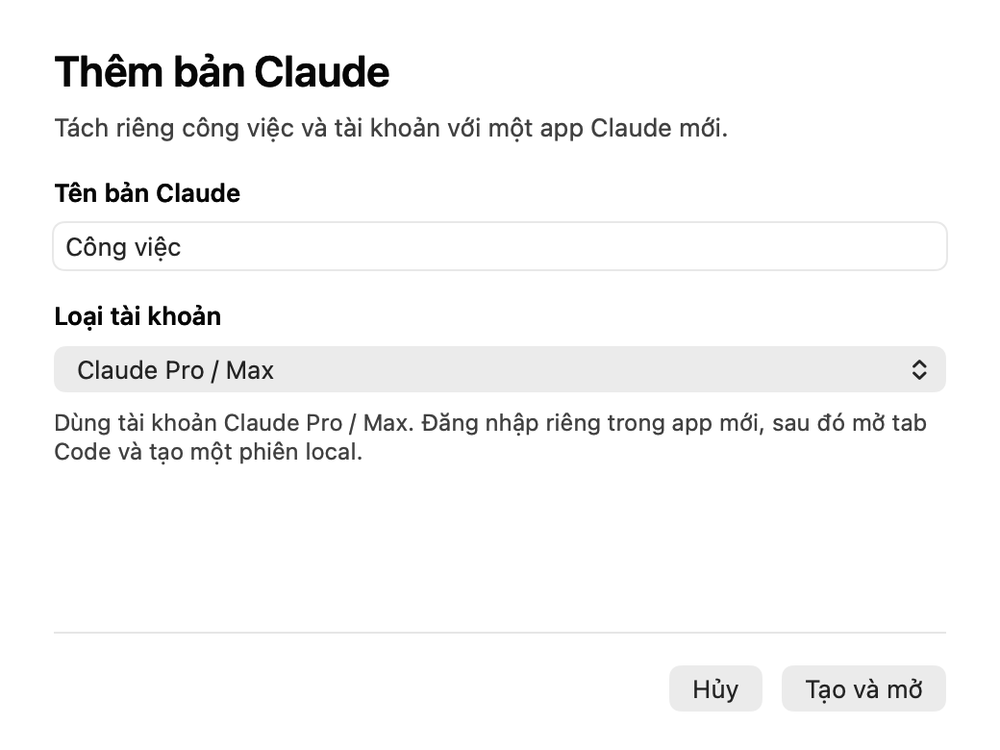

# Claude Harbor

**Nhiều tài khoản Claude. Một nơi để mở app và đồng bộ phiên Code local.**

Claude Harbor là app macOS nhỏ giúp tạo nhiều bản Claude Desktop thật, đăng nhập riêng từng tài khoản và tiếp tục lịch sử Code giữa các profile được chọn rõ ràng bằng một nút.

[Bản mới nhất: v0.4.0](https://github.com/anlvdt/claude-harbor/releases/tag/v0.4.0) · [English](README.md)



Ảnh chụp giao diện AppKit v0.3.0 ngày 15/10/2026, dùng tài khoản và lịch sử minh họa.

<details>
<summary>Xem giao diện tối</summary>



</details>

## Cách dùng

1. Cài Claude Desktop chính thức tại `/Applications/Claude.app`. Cần macOS 14+, Apple Silicon và Apple Command Line Tools (`xcode-select --install`).
2. Tải [ZIP v0.4.0 cho Apple Silicon](https://github.com/anlvdt/claude-harbor/releases/download/v0.4.0/Claude-Harbor-0.4.0-macOS-arm64.zip), giải nén rồi đặt **Claude Harbor.app** trong Applications.
3. Bấm **+ Thêm tài khoản**, đặt tên rồi đăng nhập trong bản Claude mới.
4. Mở tab **Code**, tạo một phiên **Local**, quay lại Harbor bấm **Làm mới**.
5. Khi có ít nhất hai profile sẵn sàng, chọn ô **Sync** ở các profile được phép chia sẻ lịch sử, rồi bấm **Đồng bộ đã chọn**. App chờ trả lời xong, đóng các app đang chạy, sao lưu và đồng bộ, xác minh kết quả rồi chỉ mở lại các app đã chạy trước đó. Nếu xác minh thất bại, các app vẫn đóng để bạn kiểm tra báo cáo.

**Mở / Mở tất cả** để chạy các tài khoản đồng thời. Menu **C≋** trên thanh menu giúp mở nhanh và đồng bộ. **Báo cáo & hoạt động** xem kết quả gần đây và mở thư mục báo cáo/bản sao lưu.

**v0.4.0 (build 4) đã phát hành.** Tình trạng clone hiển thị ngay tại profile; nút **Sửa** tạo lại app khi đã đóng các profile; **Kiểm tra → Phục hồi** xử lý giao dịch dở dang. Cửa sổ và menu bar cùng báo tiến trình, chỉ cho dừng lúc chờ trả lời. [Hướng dẫn release](docs/release-0.3.0.md) ghi rõ cách kiểm tra checksum, lựa chọn ký và giới hạn kiểm thử.

Giao diện mới co giãn theo cửa sổ và theo chế độ sáng/tối của macOS. Mỗi tài khoản có nhãn trạng thái, lựa chọn **Đồng bộ** và thao tác mở/sửa riêng; vùng đồng bộ giải thích rõ điều kiện còn thiếu. Form thêm tài khoản báo lỗi ngay tại trường tên và giữ nội dung nếu tạo thất bại. Phím tắt: **⌘N** thêm, **⌘O** mở tất cả, **⌘R** làm mới, **⌘I** kiểm tra và **⌘Return** đồng bộ.

Bản công khai v0.4.0 và build mặc định ký ad-hoc, chưa được Apple notarize; macOS có thể yêu cầu bạn cho phép mở app tải về. Giao diện hỗ trợ English và Tiếng Việt. Build 0.4.0 hỗ trợ tùy chọn Developer ID + hardened runtime và notarization bằng identity/profile Keychain có sẵn; máy chuẩn bị release không có identity hợp lệ hay metadata profile notarytool nên chưa kiểm thử luồng Apple thực tế.

**Nhập lịch sử…** chọn thư mục cấu hình Code chứa `projects`, tùy chọn metadata Desktop và xác nhận các tài khoản nhận. **Xác minh lịch sử** kiểm tra riêng tính nhất quán. Hai thao tác cần ít nhất một profile đã chọn và sẵn sàng, đóng các clone và xử lý lỗi chặn/phục hồi trước. Nhật ký hoạt động chỉ lưu thời gian, loại thao tác, kết quả và số lượng; báo cáo chi tiết có thể chứa thông tin riêng tư.



## Kiểm tra bản tải về

Bản 0.4.0 có **147 test Python**, test UI/backend và form Swift, cùng bộ test bản dịch đủ 16 mã lỗi backend. [CI macOS](https://github.com/anlvdt/claude-harbor/actions/workflows/ci.yml) build và kiểm tra app/ZIP/SHA256; release notes dẫn đến lần CI thành công dùng để tạo tệp phát hành.

Tải cả ZIP và [tệp SHA256](https://github.com/anlvdt/claude-harbor/releases/download/v0.4.0/Claude-Harbor-0.4.0-macOS-arm64.zip.sha256) vào cùng thư mục, rồi chạy:

```sh
shasum -a 256 -c Claude-Harbor-0.4.0-macOS-arm64.zip.sha256
```

Bộ thử headless tạo/sửa clone Claude thật và sync/xác minh dữ liệu mẫu, không mở Electron. Đã kiểm tra nâng cấp Harbor và trình xem báo cáo trên app đã cài. Đăng nhập, trả lời Code thật và mở lại clone sau repair vẫn cần kiểm thử thủ công.

## Chọn ngôn ngữ

Bản 0.4.0 hỗ trợ **English và Tiếng Việt**. Mở **Language / Ngôn ngữ → System, English hoặc Tiếng Việt** trên menu chính hoặc biểu tượng menu bar. System dùng ngôn ngữ macOS được hỗ trợ và chọn English nếu không có. Lựa chọn được lưu lại, áp dụng ngay khi app rảnh; cần kết thúc thao tác hoặc đóng hộp thoại trước khi đổi.

Tên tài khoản, nội dung hội thoại và báo cáo gốc giữ nguyên. Hộp thoại do macOS quản lý và lỗi hệ thống theo ngôn ngữ macOS. Khi đổi ngôn ngữ, thông báo gần nhất giữ nguyên bản gốc để không che mất cảnh báo đang có.

## Đã hỗ trợ

- Mỗi bản Claude có dữ liệu đăng nhập riêng.
- Đồng bộ transcript và đăng ký phiên giữa các profile đã chọn để hiện trong sidebar Code.
- Nhập lịch sử local cũ/đã lưu trữ theo nguồn và đích được chỉ định rõ ràng.
- Giữ nhiều nhánh nếu hội thoại được tiếp tục khác nhau giữa các tài khoản.
- Journal bền vững, sao lưu và phục hồi giao dịch dở dang trước khi ghi tiếp.
- **Kiểm tra** clone/profile và repair có chủ đích sau khi Claude Desktop đổi phiên bản.
- Profile chưa đăng nhập / chưa mở Code được báo chờ; các profile khác vẫn đồng bộ.

Đã đối chiếu thực tế **3.146 nhóm phiên ở ba profile**, không thiếu bản sao và không khác nội dung hội thoại trong phạm vi đã đồng bộ.

## Giới hạn

Chỉ đồng bộ **Code local trên cùng máy** của các profile đã chọn. Chưa hỗ trợ Chat web, Cowork, cloud hoặc nhiều máy; không tự khôi phục transcript đã xóa hay trên ổ chưa kết nối. Cần đóng các bản Claude trong lúc ghi đồng bộ. Sau khi Claude Desktop đổi phiên bản, dùng **Kiểm tra** rồi repair từng clone đã đóng nếu cần.

Preset Magpie là cấu hình gateway local đã kiểm chứng, chưa phải trình cấu hình API/model bất kỳ. Model cụ thể phụ thuộc routing của Magpie.

[Chi tiết cài đặt, build và dữ liệu](README.md) · [Cách đồng bộ](docs/session-sync.md).

Mã nguồn MIT. Đây là công cụ cộng đồng độc lập, không phải sản phẩm chính thức của Anthropic.
